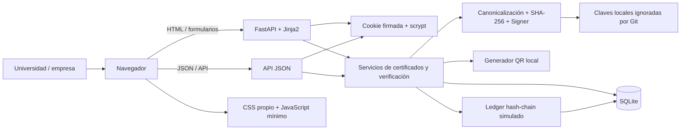
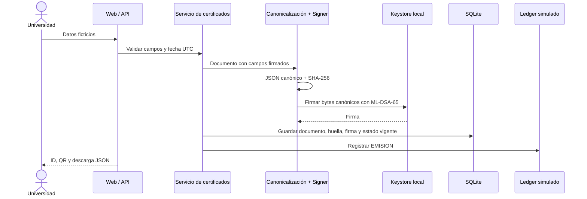
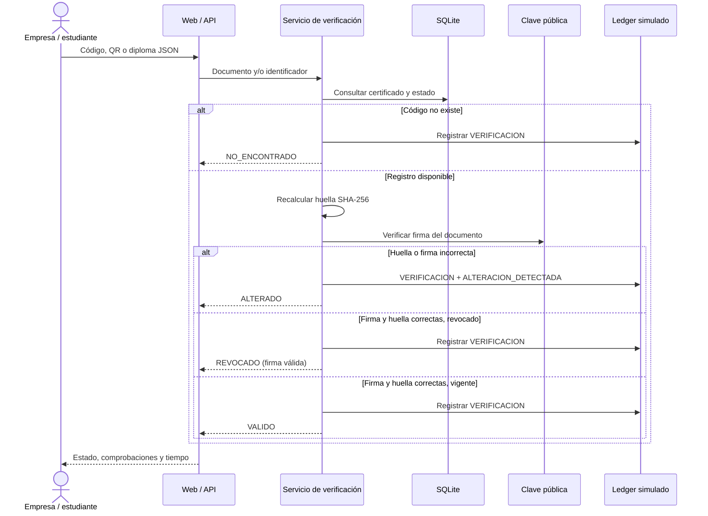

# Arquitectura DigiBlock

## Componentes



FastAPI integra las rutas y crea el esquema SQLite al arrancar. Jinja2 renderiza las páginas con autoescape; los datos de usuario no se marcan como HTML seguro. El middleware de sesión firma la cookie y limita el cuerpo de solicitudes API. SQLite se accede mediante `sqlite3` y consultas parametrizadas.

## Emisión



El documento firmado contiene `id`, `estudiante_nombre`, `estudiante_documento`, `programa`, `titulo`, `fecha_expedicion`, `universidad` y `version_esquema`. SHA-256 solo produce la huella; la clave privada firma los bytes canónicos.

## Verificación



La prioridad de decisión es `NO_ENCONTRADO`, después `ALTERADO`, luego `REVOCADO` y finalmente `VALIDO`. El diff es complementario: no sustituye la verificación criptográfica.

## Revocación

```mermaid
sequenceDiagram
	actor U as Universidad autenticada
	participant API as API protegida
	participant S as Servicio de certificados
	participant D as SQLite
	participant L as Ledger simulado

	U->>API: POST de revocación + motivo
	API->>S: Comprobar sesión y estado actual
	S->>D: Cambiar vigente a revocado
	S->>L: Registrar REVOCACION
	API-->>U: Estado revocado
	Note over D,L: La firma no se modifica; la próxima verificación informa REVOCADO
```

## Decisiones y límites

- **ML-DSA-65 (FIPS 204):** firma por defecto detrás de `Signer`. `dilithium-py` es pura en Python, educativa y no auditada para producción.
- **Ed25519:** comparación clásica del laboratorio; no se presenta como resistente a ataques cuánticos.
- **SQLite:** módulo estándar, ruta configurable y operaciones SQL parametrizadas. Los datos de demo son ficticios.
- **Hash chain:** cada evento referencia el hash anterior. Es una simulación local en SQLite: no hay nodos independientes, consenso ni anclaje externo; no garantiza la verdad de los datos.
- **Claves:** `keys/` está ignorada por Git. El prototipo no reemplaza un HSM o gestor de secretos ni implementa custodia de producción.
- **Autenticación:** scrypt, comparación en tiempo constante, bloqueo temporal y cookie firmada `HttpOnly` / `SameSite=Lax`.
- **Interfaz:** Jinja2, CSS propio y JavaScript vanilla; no depende de CDNs para la demo.
